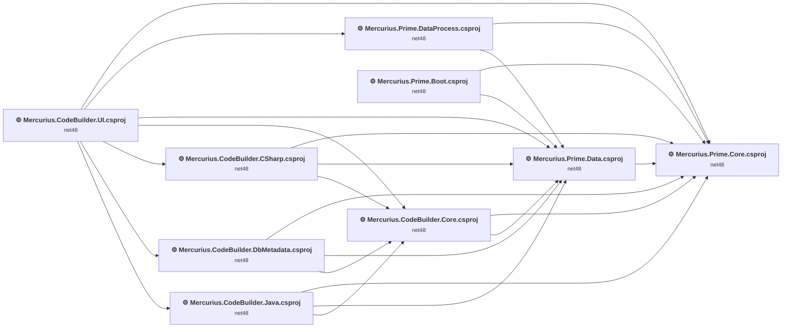
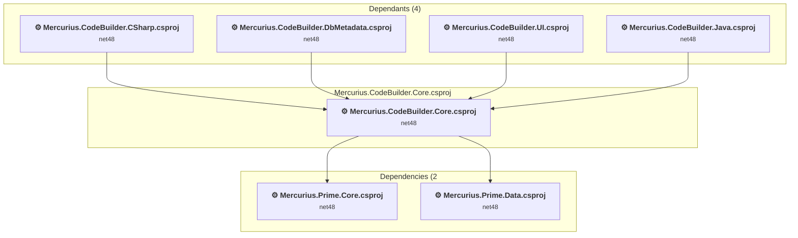
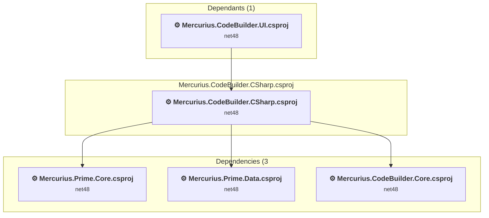
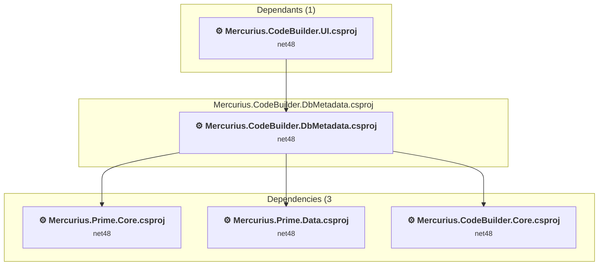
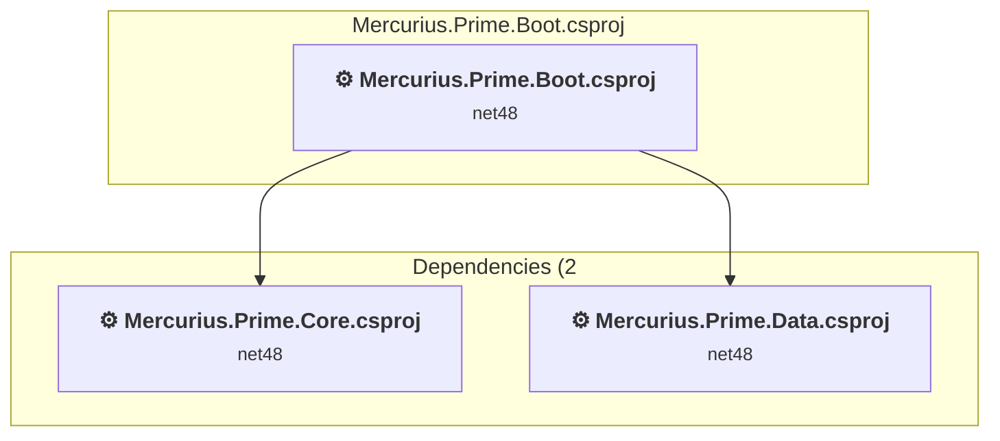
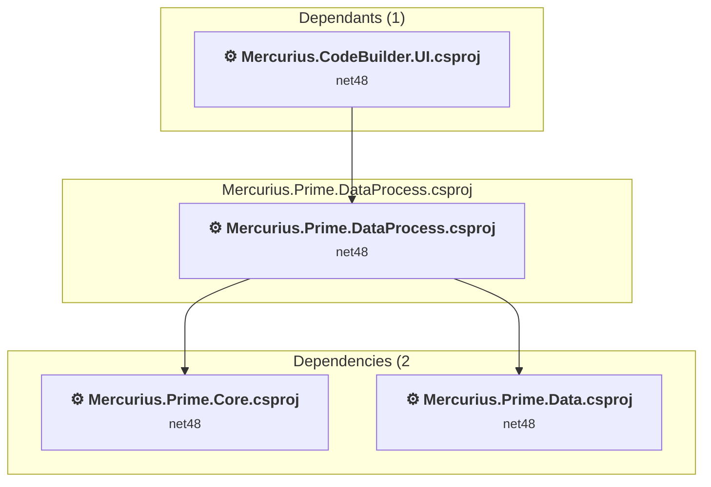

```mermaid
flowchart TB
    subgraph current["Mercurius.CodeBuilder.UI.csproj"]
        MAIN["<b>⚙️&nbsp;Mercurius.CodeBuilder.UI.csproj</b><br/><small>net48</small>"]
        click MAIN "#codebuildermercuriuscodebuilderuimercuriuscodebuilderuicsproj"
    end
    subgraph downstream["Dependencies (7"]
        P5["<b>⚙️&nbsp;Mercurius.Prime.Core.csproj</b><br/><small>net48</small>"]
        P6["<b>⚙️&nbsp;Mercurius.Prime.DataProcess.csproj</b><br/><small>net48</small>"]
        P8["<b>⚙️&nbsp;Mercurius.Prime.Data.csproj</b><br/><small>net48</small>"]
        P1["<b>⚙️&nbsp;Mercurius.CodeBuilder.Core.csproj</b><br/><small>net48</small>"]
        P2["<b>⚙️&nbsp;Mercurius.CodeBuilder.CSharp.csproj</b><br/><small>net48</small>"]
        P3["<b>⚙️&nbsp;Mercurius.CodeBuilder.DbMetadata.csproj</b><br/><small>net48</small>"]
        P7["<b>⚙️&nbsp;Mercurius.CodeBuilder.Java.csproj</b><br/><small>net48</small>"]
        click P5 "#基础mercuriusprimecoremercuriusprimecorecsproj"
        click P6 "#基础mercuriusprimedataprocessmercuriusprimedataprocesscsproj"
        click P8 "#基础mercuriusprimedatamercuriusprimedatacsproj"
        click P1 "#codebuildermercuriuscodebuildercoremercuriuscodebuildercorecsproj"
        click P2 "#codebuildermercuriuscodebuildercsharpmercuriuscodebuildercsharpcsproj"
        click P3 "#codebuildermercuriuscodebuilderdbmetadatamercuriuscodebuilderdbmetadatacsproj"
        click P7 "#codebuildermercuriuscodebuilderjavamercuriuscodebuilderjavacsproj"
    end
    MAIN --> P5
    MAIN --> P6
    MAIN --> P8
    MAIN --> P1
    MAIN --> P2
    MAIN --> P3
    MAIN --> P7

```

```mermaid
flowchart TB
    subgraph upstream["Dependants (8)"]
        P1["<b>⚙️&nbsp;Mercurius.CodeBuilder.Core.csproj</b><br/><small>net48</small>"]
        P2["<b>⚙️&nbsp;Mercurius.CodeBuilder.CSharp.csproj</b><br/><small>net48</small>"]
        P3["<b>⚙️&nbsp;Mercurius.CodeBuilder.DbMetadata.csproj</b><br/><small>net48</small>"]
        P4["<b>⚙️&nbsp;Mercurius.CodeBuilder.UI.csproj</b><br/><small>net48</small>"]
        P6["<b>⚙️&nbsp;Mercurius.Prime.DataProcess.csproj</b><br/><small>net48</small>"]
        P7["<b>⚙️&nbsp;Mercurius.CodeBuilder.Java.csproj</b><br/><small>net48</small>"]
        P8["<b>⚙️&nbsp;Mercurius.Prime.Data.csproj</b><br/><small>net48</small>"]
        P9["<b>⚙️&nbsp;Mercurius.Prime.Boot.csproj</b><br/><small>net48</small>"]
        click P1 "#codebuildermercuriuscodebuildercoremercuriuscodebuildercorecsproj"
        click P2 "#codebuildermercuriuscodebuildercsharpmercuriuscodebuildercsharpcsproj"
        click P3 "#codebuildermercuriuscodebuilderdbmetadatamercuriuscodebuilderdbmetadatacsproj"
        click P4 "#codebuildermercuriuscodebuilderuimercuriuscodebuilderuicsproj"
        click P6 "#基础mercuriusprimedataprocessmercuriusprimedataprocesscsproj"
        click P7 "#codebuildermercuriuscodebuilderjavamercuriuscodebuilderjavacsproj"
        click P8 "#基础mercuriusprimedatamercuriusprimedatacsproj"
        click P9 "#基础mercuriusprimebootmercuriusprimebootcsproj"
    end
    subgraph current["Mercurius.Prime.Core.csproj"]
        MAIN["<b>⚙️&nbsp;Mercurius.Prime.Core.csproj</b><br/><small>net48</small>"]
        click MAIN "#基础mercuriusprimecoremercuriusprimecorecsproj"
    end
    P1 --> MAIN
    P2 --> MAIN
    P3 --> MAIN
    P4 --> MAIN
    P6 --> MAIN
    P7 --> MAIN
    P8 --> MAIN
    P9 --> MAIN

```

```mermaid
flowchart TB
    subgraph upstream["Dependants (7)"]
        P1["<b>⚙️&nbsp;Mercurius.CodeBuilder.Core.csproj</b><br/><small>net48</small>"]
        P2["<b>⚙️&nbsp;Mercurius.CodeBuilder.CSharp.csproj</b><br/><small>net48</small>"]
        P3["<b>⚙️&nbsp;Mercurius.CodeBuilder.DbMetadata.csproj</b><br/><small>net48</small>"]
        P4["<b>⚙️&nbsp;Mercurius.CodeBuilder.UI.csproj</b><br/><small>net48</small>"]
        P6["<b>⚙️&nbsp;Mercurius.Prime.DataProcess.csproj</b><br/><small>net48</small>"]
        P7["<b>⚙️&nbsp;Mercurius.CodeBuilder.Java.csproj</b><br/><small>net48</small>"]
        P9["<b>⚙️&nbsp;Mercurius.Prime.Boot.csproj</b><br/><small>net48</small>"]
        click P1 "#codebuildermercuriuscodebuildercoremercuriuscodebuildercorecsproj"
        click P2 "#codebuildermercuriuscodebuildercsharpmercuriuscodebuildercsharpcsproj"
        click P3 "#codebuildermercuriuscodebuilderdbmetadatamercuriuscodebuilderdbmetadatacsproj"
        click P4 "#codebuildermercuriuscodebuilderuimercuriuscodebuilderuicsproj"
        click P6 "#基础mercuriusprimedataprocessmercuriusprimedataprocesscsproj"
        click P7 "#codebuildermercuriuscodebuilderjavamercuriuscodebuilderjavacsproj"
        click P9 "#基础mercuriusprimebootmercuriusprimebootcsproj"
    end
    subgraph current["Mercurius.Prime.Data.csproj"]
        MAIN["<b>⚙️&nbsp;Mercurius.Prime.Data.csproj</b><br/><small>net48</small>"]
        click MAIN "#基础mercuriusprimedatamercuriusprimedatacsproj"
    end
    subgraph downstream["Dependencies (1"]
        P5["<b>⚙️&nbsp;Mercurius.Prime.Core.csproj</b><br/><small>net48</small>"]
        click P5 "#基础mercuriusprimecoremercuriusprimecorecsproj"
    end
    P1 --> MAIN
    P2 --> MAIN
    P3 --> MAIN
    P4 --> MAIN
    P6 --> MAIN
    P7 --> MAIN
    P9 --> MAIN
    MAIN --> P5

```

# Projects and dependencies analysis

This document provides a comprehensive overview of the projects and their dependencies in the context of upgrading to .NETCoreApp,Version=v10.0.

## Table of Contents

- [Executive Summary](#executive-Summary)
  - [Highlevel Metrics](#highlevel-metrics)
  - [Projects Compatibility](#projects-compatibility)
  - [Package Compatibility](#package-compatibility)
  - [API Compatibility](#api-compatibility)
  - [Binding Redirect Configuration](#binding-redirect-configuration)
- [Aggregate NuGet packages details](#aggregate-nuget-packages-details)
- [Top API Migration Challenges](#top-api-migration-challenges)
  - [Technologies and Features](#technologies-and-features)
  - [Most Frequent API Issues](#most-frequent-api-issues)
- [Projects Relationship Graph](#projects-relationship-graph)
- [Project Details](#project-details)

  - [CodeBuilder\Mercurius.CodeBuilder.Core\Mercurius.CodeBuilder.Core.csproj](#codebuildermercuriuscodebuildercoremercuriuscodebuildercorecsproj)
  - [CodeBuilder\Mercurius.CodeBuilder.CSharp\Mercurius.CodeBuilder.CSharp.csproj](#codebuildermercuriuscodebuildercsharpmercuriuscodebuildercsharpcsproj)
  - [CodeBuilder\Mercurius.CodeBuilder.DbMetadata\Mercurius.CodeBuilder.DbMetadata.csproj](#codebuildermercuriuscodebuilderdbmetadatamercuriuscodebuilderdbmetadatacsproj)
  - [CodeBuilder\Mercurius.CodeBuilder.Java\Mercurius.CodeBuilder.Java.csproj](#codebuildermercuriuscodebuilderjavamercuriuscodebuilderjavacsproj)
  - [CodeBuilder\Mercurius.CodeBuilder.UI\Mercurius.CodeBuilder.UI.csproj](#codebuildermercuriuscodebuilderuimercuriuscodebuilderuicsproj)
  - [基础\Mercurius.Prime.Boot\Mercurius.Prime.Boot.csproj](#基础mercuriusprimebootmercuriusprimebootcsproj)
  - [基础\Mercurius.Prime.Core\Mercurius.Prime.Core.csproj](#基础mercuriusprimecoremercuriusprimecorecsproj)
  - [基础\Mercurius.Prime.Data\Mercurius.Prime.Data.csproj](#基础mercuriusprimedatamercuriusprimedatacsproj)
  - [基础\Mercurius.Prime.DataProcess\Mercurius.Prime.DataProcess.csproj](#基础mercuriusprimedataprocessmercuriusprimedataprocesscsproj)

## Executive Summary

### Highlevel Metrics

| Metric | Count | Status |
| :--- | :---: | :--- |
| Total Projects | 9 | All require upgrade |
| Total NuGet Packages | 91 | 29 need upgrade |
| Total Code Files | 169 |  |
| Total Code Files with Incidents | 70 |  |
| Total Lines of Code | 20007 |  |
| Total Number of Issues | 1707 |  |
| Estimated LOC to modify | 1504+ | at least 7.5% of codebase |

### Projects Compatibility

| Project | Target Framework | Difficulty | Package Issues | API Issues | Binding Issues | Est. LOC Impact | Description |
| :--- | :---: | :---: | :---: | :---: | :---: | :---: | :--- |
| [CodeBuilder\Mercurius.CodeBuilder.Core\Mercurius.CodeBuilder.Core.csproj](#codebuildermercuriuscodebuildercoremercuriuscodebuildercorecsproj) | net48 | 🟢 Low | 2 | 9 | 3 | 9+ | ClassicWpf, Sdk Style = False |
| [CodeBuilder\Mercurius.CodeBuilder.CSharp\Mercurius.CodeBuilder.CSharp.csproj](#codebuildermercuriuscodebuildercsharpmercuriuscodebuildercsharpcsproj) | net48 | 🟢 Low | 3 | 0 | 2 |  | ClassicWpf, Sdk Style = False |
| [CodeBuilder\Mercurius.CodeBuilder.DbMetadata\Mercurius.CodeBuilder.DbMetadata.csproj](#codebuildermercuriuscodebuilderdbmetadatamercuriuscodebuilderdbmetadatacsproj) | net48 | 🟢 Low | 7 | 0 | 10 |  | ClassicClassLibrary, Sdk Style = False |
| [CodeBuilder\Mercurius.CodeBuilder.Java\Mercurius.CodeBuilder.Java.csproj](#codebuildermercuriuscodebuilderjavamercuriuscodebuilderjavacsproj) | net48 | 🟢 Low | 0 | 0 | 0 |  | ClassicClassLibrary, Sdk Style = False |
| [CodeBuilder\Mercurius.CodeBuilder.UI\Mercurius.CodeBuilder.UI.csproj](#codebuildermercuriuscodebuilderuimercuriuscodebuilderuicsproj) | net48 | 🟡 Medium | 19 | 973 | 16 | 973+ | ClassicWinForms, Sdk Style = False |
| [基础\Mercurius.Prime.Boot\Mercurius.Prime.Boot.csproj](#基础mercuriusprimebootmercuriusprimebootcsproj) | net48 | 🟡 Medium | 21 | 87 | 13 | 87+ | ClassicClassLibrary, Sdk Style = False |
| [基础\Mercurius.Prime.Core\Mercurius.Prime.Core.csproj](#基础mercuriusprimecoremercuriusprimecorecsproj) | net48 | 🔴 High | 13 | 435 | 15 | 435+ | ClassicClassLibrary, Sdk Style = False |
| [基础\Mercurius.Prime.Data\Mercurius.Prime.Data.csproj](#基础mercuriusprimedatamercuriusprimedatacsproj) | net48 | 🟢 Low | 32 | 0 | 25 |  | ClassicClassLibrary, Sdk Style = False |
| [基础\Mercurius.Prime.DataProcess\Mercurius.Prime.DataProcess.csproj](#基础mercuriusprimedataprocessmercuriusprimedataprocesscsproj) | net48 | 🟢 Low | 1 | 0 | 3 |  | ClassicClassLibrary, Sdk Style = False |

### Package Compatibility

| Status | Count | Percentage |
| :--- | :---: | :---: |
| ✅ Compatible | 62 | 68.1% |
| ⚠️ Incompatible | 15 | 16.5% |
| 🔄 Upgrade Recommended | 14 | 15.4% |
| ***Total NuGet Packages*** | ***91*** | ***100%*** |

### API Compatibility

| Category | Count | Impact |
| :--- | :---: | :--- |
| 🔴 Binary Incompatible | 1076 | High - Require code changes |
| 🟡 Source Incompatible | 412 | Medium - Needs re-compilation and potential conflicting API error fixing |
| 🔵 Behavioral change | 16 | Low - Behavioral changes that may require testing at runtime |
| ✅ Compatible | 12389 |  |
| ***Total APIs Analyzed*** | ***13893*** |  |

### Binding Redirect Configuration

| Severity | Count | Description |
| :--- | :---: | :--- |
| 🔴Mandatory | 23 | Must be fixed to avoid runtime failures |
| 🟡Potential | 64 | May cause issues in certain scenarios |
| ***Total Binding Issues*** | ***87*** | ***Across 8 project(s)*** |

## Aggregate NuGet packages details

| Package | Current Version | Suggested Version | Projects | Description |
| :--- | :---: | :---: | :--- | :--- |
| Autofac | 6.4.0 |  | [Mercurius.Prime.Boot.csproj](#基础mercuriusprimebootmercuriusprimebootcsproj) | ✅Compatible |
| Autofac.Extras.DynamicProxy | 6.0.1 |  | [Mercurius.Prime.Boot.csproj](#基础mercuriusprimebootmercuriusprimebootcsproj) | ✅Compatible |
| Autofac.Mvc5 | 6.1.0 |  | [Mercurius.Prime.Boot.csproj](#基础mercuriusprimebootmercuriusprimebootcsproj) | ⚠️NuGet 包不兼容 |
| Autofac.WebApi2 | 6.1.1 |  | [Mercurius.Prime.Boot.csproj](#基础mercuriusprimebootmercuriusprimebootcsproj) | ⚠️NuGet 包不兼容 |
| AutoMapper | 10.1.1 | 16.3.0 | [Mercurius.Prime.Data.csproj](#基础mercuriusprimedatamercuriusprimedatacsproj) | NuGet 包有安全漏洞 |
| BouncyCastle | 1.8.9 | 1.8.9 | [Mercurius.CodeBuilder.DbMetadata.csproj](#codebuildermercuriuscodebuilderdbmetadatamercuriuscodebuilderdbmetadatacsproj) [Mercurius.CodeBuilder.UI.csproj](#codebuildermercuriuscodebuilderuimercuriuscodebuilderuicsproj) | NuGet 包有安全漏洞 |
| Castle.Core | 5.1.0 |  | [Mercurius.Prime.Boot.csproj](#基础mercuriusprimebootmercuriusprimebootcsproj) [Mercurius.Prime.Data.csproj](#基础mercuriusprimedatamercuriusprimedatacsproj) | ✅Compatible |
| CommonServiceLocator | 2.0.6 |  | [Mercurius.CodeBuilder.Core.csproj](#codebuildermercuriuscodebuildercoremercuriuscodebuildercorecsproj) [Mercurius.CodeBuilder.CSharp.csproj](#codebuildermercuriuscodebuildercsharpmercuriuscodebuildercsharpcsproj) [Mercurius.CodeBuilder.UI.csproj](#codebuildermercuriuscodebuilderuimercuriuscodebuilderuicsproj) | ⚠️NuGet 包已弃用 |
| Dapper | 2.0.123 |  | [Mercurius.Prime.Data.csproj](#基础mercuriusprimedatamercuriusprimedatacsproj) | ✅Compatible |
| DotNetZip | 1.16.0 | 1.16.0 | [Mercurius.CodeBuilder.CSharp.csproj](#codebuildermercuriuscodebuildercsharpmercuriuscodebuildercsharpcsproj) | NuGet 包有安全漏洞 |
| EnterpriseLibrary.Common | 6.0.1304.0 |  | [Mercurius.Prime.Core.csproj](#基础mercuriusprimecoremercuriusprimecorecsproj) | ⚠️NuGet 包不兼容 |
| EnterpriseLibrary.Validation | 6.0.1304.0 |  | [Mercurius.Prime.Core.csproj](#基础mercuriusprimecoremercuriusprimecorecsproj) | ⚠️NuGet 包不兼容 |
| FromHeaderAttribute | 2.0.4 |  | [Mercurius.Prime.Boot.csproj](#基础mercuriusprimebootmercuriusprimebootcsproj) | ⚠️NuGet 包不兼容 |
| Google.Protobuf | 3.21.6 |  | [Mercurius.CodeBuilder.DbMetadata.csproj](#codebuildermercuriuscodebuilderdbmetadatamercuriuscodebuilderdbmetadatacsproj) [Mercurius.CodeBuilder.UI.csproj](#codebuildermercuriuscodebuilderuimercuriuscodebuilderuicsproj) | ✅Compatible |
| IBatisNet45 | 1.6.2 |  | [Mercurius.Prime.Data.csproj](#基础mercuriusprimedatamercuriusprimedatacsproj) | ⚠️NuGet 包不兼容 |
| K4os.Compression.LZ4 | 1.2.16 |  | [Mercurius.CodeBuilder.DbMetadata.csproj](#codebuildermercuriuscodebuilderdbmetadatamercuriuscodebuilderdbmetadatacsproj) [Mercurius.CodeBuilder.UI.csproj](#codebuildermercuriuscodebuilderuimercuriuscodebuilderuicsproj) | ✅Compatible |
| K4os.Compression.LZ4.Streams | 1.2.16 |  | [Mercurius.CodeBuilder.DbMetadata.csproj](#codebuildermercuriuscodebuilderdbmetadatamercuriuscodebuilderdbmetadatacsproj) [Mercurius.CodeBuilder.UI.csproj](#codebuildermercuriuscodebuilderuimercuriuscodebuilderuicsproj) | ✅Compatible |
| K4os.Hash.xxHash | 1.0.7 |  | [Mercurius.CodeBuilder.DbMetadata.csproj](#codebuildermercuriuscodebuilderdbmetadatamercuriuscodebuilderdbmetadatacsproj) [Mercurius.CodeBuilder.UI.csproj](#codebuildermercuriuscodebuilderuimercuriuscodebuilderuicsproj) | ✅Compatible |
| log4net | 2.0.15 | 3.5.0 | [Mercurius.Prime.Data.csproj](#基础mercuriusprimedatamercuriusprimedatacsproj) | NuGet 包有安全漏洞 |
| Microsoft.AspNet.Cors | 5.2.9 |  | [Mercurius.Prime.Boot.csproj](#基础mercuriusprimebootmercuriusprimebootcsproj) | 框架引用中包含 NuGet 包功能 |
| Microsoft.AspNet.Mvc | 5.2.9 |  | [Mercurius.Prime.Boot.csproj](#基础mercuriusprimebootmercuriusprimebootcsproj) | 框架引用中包含 NuGet 包功能 |
| Microsoft.AspNet.Razor | 3.2.9 |  | [Mercurius.Prime.Boot.csproj](#基础mercuriusprimebootmercuriusprimebootcsproj) | 框架引用中包含 NuGet 包功能 |
| Microsoft.AspNet.WebApi | 5.2.9 |  | [Mercurius.Prime.Boot.csproj](#基础mercuriusprimebootmercuriusprimebootcsproj) | 框架引用中包含 NuGet 包功能 |
| Microsoft.AspNet.WebApi.Client | 5.2.9 |  | [Mercurius.Prime.Boot.csproj](#基础mercuriusprimebootmercuriusprimebootcsproj) | ✅Compatible |
| Microsoft.AspNet.WebApi.Core | 5.2.9 |  | [Mercurius.Prime.Boot.csproj](#基础mercuriusprimebootmercuriusprimebootcsproj) | ⚠️NuGet 包不兼容 |
| Microsoft.AspNet.WebApi.Cors | 5.2.9 |  | [Mercurius.Prime.Boot.csproj](#基础mercuriusprimebootmercuriusprimebootcsproj) | ⚠️Replace with Microsoft.AspNetCore.Cors: Register CORS policies with services.AddCors(); call app.UseCors() or [EnableCors] attribute |
| Microsoft.AspNet.WebApi.WebHost | 5.2.9 |  | [Mercurius.Prime.Boot.csproj](#基础mercuriusprimebootmercuriusprimebootcsproj) | ⚠️NuGet 包不兼容 |
| Microsoft.AspNet.WebPages | 3.2.9 |  | [Mercurius.Prime.Boot.csproj](#基础mercuriusprimebootmercuriusprimebootcsproj) | 框架引用中包含 NuGet 包功能 |
| Microsoft.Bcl.AsyncInterfaces | 6.0.0 | 10.0.15 | [Mercurius.CodeBuilder.UI.csproj](#codebuildermercuriuscodebuilderuimercuriuscodebuilderuicsproj) [Mercurius.Prime.Boot.csproj](#基础mercuriusprimebootmercuriusprimebootcsproj) [Mercurius.Prime.Core.csproj](#基础mercuriusprimecoremercuriusprimecorecsproj) | 建议升级 NuGet 包 |
| Microsoft.Expression.Drawing | 3.0.0 |  | [Mercurius.CodeBuilder.UI.csproj](#codebuildermercuriuscodebuilderuimercuriuscodebuilderuicsproj) | ⚠️NuGet 包不兼容 |
| Microsoft.Web.Infrastructure | 2.0.0 |  | [Mercurius.Prime.Boot.csproj](#基础mercuriusprimebootmercuriusprimebootcsproj) | 框架引用中包含 NuGet 包功能 |
| Microsoft.Xaml.Behaviors.Wpf | 1.1.39 |  | [Mercurius.CodeBuilder.UI.csproj](#codebuildermercuriuscodebuilderuimercuriuscodebuilderuicsproj) | ✅Compatible |
| MySql.Data | 8.0.30 |  | [Mercurius.CodeBuilder.DbMetadata.csproj](#codebuildermercuriuscodebuilderdbmetadatamercuriuscodebuilderdbmetadatacsproj) [Mercurius.CodeBuilder.UI.csproj](#codebuildermercuriuscodebuilderuimercuriuscodebuilderuicsproj) | ✅Compatible |
| Newtonsoft.Json | 13.0.1 | 13.0.4 | [Mercurius.CodeBuilder.Core.csproj](#codebuildermercuriuscodebuildercoremercuriuscodebuildercorecsproj) [Mercurius.Prime.Boot.csproj](#基础mercuriusprimebootmercuriusprimebootcsproj) [Mercurius.Prime.Core.csproj](#基础mercuriusprimecoremercuriusprimecorecsproj) [Mercurius.Prime.Data.csproj](#基础mercuriusprimedatamercuriusprimedatacsproj) | 建议升级 NuGet 包 |
| NLog | 5.0.4 |  | [Mercurius.Prime.Boot.csproj](#基础mercuriusprimebootmercuriusprimebootcsproj) [Mercurius.Prime.Core.csproj](#基础mercuriusprimecoremercuriusprimecorecsproj) | ✅Compatible |
| NPOI | 2.5.6 |  | [Mercurius.Prime.DataProcess.csproj](#基础mercuriusprimedataprocessmercuriusprimedataprocesscsproj) | ⚠️NuGet 包已弃用 |
| Oracle.ManagedDataAccess | 21.7.0 |  | [Mercurius.CodeBuilder.UI.csproj](#codebuildermercuriuscodebuilderuimercuriuscodebuilderuicsproj) | ⚠️NuGet 包不兼容 |
| Pipelines.Sockets.Unofficial | 2.2.2 |  | [Mercurius.Prime.Core.csproj](#基础mercuriusprimecoremercuriusprimecorecsproj) | ✅Compatible |
| Portable.BouncyCastle | 1.9.0 |  | [Mercurius.CodeBuilder.DbMetadata.csproj](#codebuildermercuriuscodebuilderdbmetadatamercuriuscodebuilderdbmetadatacsproj) [Mercurius.CodeBuilder.UI.csproj](#codebuildermercuriuscodebuilderuimercuriuscodebuilderuicsproj) [Mercurius.Prime.DataProcess.csproj](#基础mercuriusprimedataprocessmercuriusprimedataprocesscsproj) | ✅Compatible |
| Prism.Core | 8.1.97 |  | [Mercurius.CodeBuilder.Core.csproj](#codebuildermercuriuscodebuildercoremercuriuscodebuildercorecsproj) [Mercurius.CodeBuilder.CSharp.csproj](#codebuildermercuriuscodebuildercsharpmercuriuscodebuildercsharpcsproj) [Mercurius.CodeBuilder.UI.csproj](#codebuildermercuriuscodebuilderuimercuriuscodebuilderuicsproj) | ✅Compatible |
| Prism.Unity | 8.1.97 |  | [Mercurius.CodeBuilder.UI.csproj](#codebuildermercuriuscodebuilderuimercuriuscodebuilderuicsproj) | ✅Compatible |
| Prism.Wpf | 8.1.97 |  | [Mercurius.CodeBuilder.UI.csproj](#codebuildermercuriuscodebuilderuimercuriuscodebuilderuicsproj) | ✅Compatible |
| SharpZipLib | 1.3.3 |  | [Mercurius.Prime.DataProcess.csproj](#基础mercuriusprimedataprocessmercuriusprimedataprocesscsproj) | ✅Compatible |
| SSH.NET | 2020.0.2 | 2026.0.0 | [Mercurius.CodeBuilder.DbMetadata.csproj](#codebuildermercuriuscodebuilderdbmetadatamercuriuscodebuilderdbmetadatacsproj) [Mercurius.CodeBuilder.UI.csproj](#codebuildermercuriuscodebuilderuimercuriuscodebuilderuicsproj) | NuGet 包有安全漏洞 |
| StackExchange.Redis | 2.6.66 |  | [Mercurius.Prime.Core.csproj](#基础mercuriusprimecoremercuriusprimecorecsproj) | ✅Compatible |
| Swagger-Net | 8.4.14.1 |  | [Mercurius.Prime.Boot.csproj](#基础mercuriusprimebootmercuriusprimebootcsproj) | ⚠️NuGet 包不兼容 |
| System.AppContext | 4.3.0 |  | [Mercurius.Prime.Data.csproj](#基础mercuriusprimedatamercuriusprimedatacsproj) | 框架引用中包含 NuGet 包功能 |
| System.Buffers | 4.5.1 |  | [Mercurius.CodeBuilder.DbMetadata.csproj](#codebuildermercuriuscodebuilderdbmetadatamercuriuscodebuilderdbmetadatacsproj) [Mercurius.CodeBuilder.UI.csproj](#codebuildermercuriuscodebuilderuimercuriuscodebuilderuicsproj) [Mercurius.Prime.Boot.csproj](#基础mercuriusprimebootmercuriusprimebootcsproj) [Mercurius.Prime.Core.csproj](#基础mercuriusprimecoremercuriusprimecorecsproj) | 框架引用中包含 NuGet 包功能 |
| System.Collections.NonGeneric | 4.3.0 |  | [Mercurius.Prime.Data.csproj](#基础mercuriusprimedatamercuriusprimedatacsproj) | 框架引用中包含 NuGet 包功能 |
| System.Console | 4.3.1 |  | [Mercurius.Prime.Data.csproj](#基础mercuriusprimedatamercuriusprimedatacsproj) | 框架引用中包含 NuGet 包功能 |
| System.Diagnostics.Debug | 4.3.0 |  | [Mercurius.Prime.Data.csproj](#基础mercuriusprimedatamercuriusprimedatacsproj) | 框架引用中包含 NuGet 包功能 |
| System.Diagnostics.DiagnosticSource | 6.0.0 | 10.0.15 | [Mercurius.Prime.Boot.csproj](#基础mercuriusprimebootmercuriusprimebootcsproj) | 建议升级 NuGet 包 |
| System.Diagnostics.PerformanceCounter | 6.0.1 | 10.0.15 | [Mercurius.Prime.Core.csproj](#基础mercuriusprimecoremercuriusprimecorecsproj) | 建议升级 NuGet 包 |
| System.Diagnostics.Process | 4.3.0 |  | [Mercurius.Prime.Data.csproj](#基础mercuriusprimedatamercuriusprimedatacsproj) | 框架引用中包含 NuGet 包功能 |
| System.Diagnostics.StackTrace | 4.3.0 |  | [Mercurius.Prime.Data.csproj](#基础mercuriusprimedatamercuriusprimedatacsproj) | 框架引用中包含 NuGet 包功能 |
| System.Diagnostics.TraceSource | 4.3.0 |  | [Mercurius.Prime.Data.csproj](#基础mercuriusprimedatamercuriusprimedatacsproj) | 框架引用中包含 NuGet 包功能 |
| System.IO.Compression | 4.3.0 |  | [Mercurius.Prime.Core.csproj](#基础mercuriusprimecoremercuriusprimecorecsproj) | 框架引用中包含 NuGet 包功能 |
| System.IO.FileSystem | 4.3.0 |  | [Mercurius.Prime.Data.csproj](#基础mercuriusprimedatamercuriusprimedatacsproj) | 框架引用中包含 NuGet 包功能 |
| System.IO.FileSystem.Primitives | 4.3.0 |  | [Mercurius.Prime.Data.csproj](#基础mercuriusprimedatamercuriusprimedatacsproj) | 框架引用中包含 NuGet 包功能 |
| System.IO.FileSystem.Watcher | 4.3.0 |  | [Mercurius.Prime.Data.csproj](#基础mercuriusprimedatamercuriusprimedatacsproj) | 框架引用中包含 NuGet 包功能 |
| System.IO.Pipelines | 6.0.3 | 10.0.15 | [Mercurius.Prime.Core.csproj](#基础mercuriusprimecoremercuriusprimecorecsproj) | 建议升级 NuGet 包 |
| System.Linq | 4.3.0 |  | [Mercurius.Prime.Data.csproj](#基础mercuriusprimedatamercuriusprimedatacsproj) | 框架引用中包含 NuGet 包功能 |
| System.Memory | 4.5.5 |  | [Mercurius.CodeBuilder.DbMetadata.csproj](#codebuildermercuriuscodebuilderdbmetadatamercuriuscodebuilderdbmetadatacsproj) [Mercurius.CodeBuilder.UI.csproj](#codebuildermercuriuscodebuilderuimercuriuscodebuilderuicsproj) [Mercurius.Prime.Boot.csproj](#基础mercuriusprimebootmercuriusprimebootcsproj) [Mercurius.Prime.Core.csproj](#基础mercuriusprimecoremercuriusprimecorecsproj) | 框架引用中包含 NuGet 包功能 |
| System.Net.NameResolution | 4.3.0 |  | [Mercurius.Prime.Data.csproj](#基础mercuriusprimedatamercuriusprimedatacsproj) | 框架引用中包含 NuGet 包功能 |
| System.Net.Requests | 4.3.0 |  | [Mercurius.Prime.Data.csproj](#基础mercuriusprimedatamercuriusprimedatacsproj) | 框架引用中包含 NuGet 包功能 |
| System.Net.Sockets | 4.3.0 |  | [Mercurius.Prime.Data.csproj](#基础mercuriusprimedatamercuriusprimedatacsproj) | 框架引用中包含 NuGet 包功能 |
| System.Numerics.Vectors | 4.5.0 |  | [Mercurius.CodeBuilder.DbMetadata.csproj](#codebuildermercuriuscodebuilderdbmetadatamercuriuscodebuilderdbmetadatacsproj) [Mercurius.CodeBuilder.UI.csproj](#codebuildermercuriuscodebuilderuimercuriuscodebuilderuicsproj) [Mercurius.Prime.Boot.csproj](#基础mercuriusprimebootmercuriusprimebootcsproj) [Mercurius.Prime.Core.csproj](#基础mercuriusprimecoremercuriusprimecorecsproj) | 框架引用中包含 NuGet 包功能 |
| System.Reflection | 4.3.0 |  | [Mercurius.Prime.Data.csproj](#基础mercuriusprimedatamercuriusprimedatacsproj) | 框架引用中包含 NuGet 包功能 |
| System.Reflection.Extensions | 4.3.0 |  | [Mercurius.Prime.Data.csproj](#基础mercuriusprimedatamercuriusprimedatacsproj) | 框架引用中包含 NuGet 包功能 |
| System.Reflection.TypeExtensions | 4.7.0 |  | [Mercurius.Prime.Data.csproj](#基础mercuriusprimedatamercuriusprimedatacsproj) | 框架引用中包含 NuGet 包功能 |
| System.Runtime.CompilerServices.Unsafe | 6.0.0 | 6.1.2 | [Mercurius.CodeBuilder.DbMetadata.csproj](#codebuildermercuriuscodebuilderdbmetadatamercuriuscodebuilderdbmetadatacsproj) [Mercurius.CodeBuilder.UI.csproj](#codebuildermercuriuscodebuilderuimercuriuscodebuilderuicsproj) [Mercurius.Prime.Boot.csproj](#基础mercuriusprimebootmercuriusprimebootcsproj) [Mercurius.Prime.Core.csproj](#基础mercuriusprimecoremercuriusprimecorecsproj) | 建议升级 NuGet 包 |
| System.Runtime.Extensions | 4.3.1 |  | [Mercurius.Prime.Data.csproj](#基础mercuriusprimedatamercuriusprimedatacsproj) | 框架引用中包含 NuGet 包功能 |
| System.Runtime.InteropServices | 4.3.0 |  | [Mercurius.Prime.Data.csproj](#基础mercuriusprimedatamercuriusprimedatacsproj) | 框架引用中包含 NuGet 包功能 |
| System.Runtime.InteropServices.RuntimeInformation | 4.3.0 |  | [Mercurius.Prime.Data.csproj](#基础mercuriusprimedatamercuriusprimedatacsproj) | 框架引用中包含 NuGet 包功能 |
| System.Runtime.Serialization.Formatters | 4.3.0 |  | [Mercurius.Prime.Data.csproj](#基础mercuriusprimedatamercuriusprimedatacsproj) | 框架引用中包含 NuGet 包功能 |
| System.Runtime.Serialization.Primitives | 4.3.0 |  | [Mercurius.Prime.Data.csproj](#基础mercuriusprimedatamercuriusprimedatacsproj) | 框架引用中包含 NuGet 包功能 |
| System.Text.Encodings.Web | 6.0.0 | 10.0.15 | [Mercurius.CodeBuilder.UI.csproj](#codebuildermercuriuscodebuilderuimercuriuscodebuilderuicsproj) | 建议升级 NuGet 包 |
| System.Text.Json | 6.0.6 | 10.0.15 | [Mercurius.CodeBuilder.UI.csproj](#codebuildermercuriuscodebuilderuimercuriuscodebuilderuicsproj) | 建议升级 NuGet 包 |
| System.Text.RegularExpressions | 4.3.1 |  | [Mercurius.Prime.Data.csproj](#基础mercuriusprimedatamercuriusprimedatacsproj) | 框架引用中包含 NuGet 包功能 |
| System.Threading | 4.3.0 |  | [Mercurius.Prime.Data.csproj](#基础mercuriusprimedatamercuriusprimedatacsproj) | 框架引用中包含 NuGet 包功能 |
| System.Threading.Channels | 6.0.0 | 10.0.15 | [Mercurius.Prime.Core.csproj](#基础mercuriusprimecoremercuriusprimecorecsproj) | 建议升级 NuGet 包 |
| System.Threading.Tasks.Extensions | 4.5.4 |  | [Mercurius.CodeBuilder.UI.csproj](#codebuildermercuriuscodebuilderuimercuriuscodebuilderuicsproj) [Mercurius.Prime.Boot.csproj](#基础mercuriusprimebootmercuriusprimebootcsproj) [Mercurius.Prime.Core.csproj](#基础mercuriusprimecoremercuriusprimecorecsproj) | 框架引用中包含 NuGet 包功能 |
| System.Threading.Thread | 4.3.0 |  | [Mercurius.Prime.Data.csproj](#基础mercuriusprimedatamercuriusprimedatacsproj) | 框架引用中包含 NuGet 包功能 |
| System.Threading.Timer | 4.3.0 |  | [Mercurius.Prime.Data.csproj](#基础mercuriusprimedatamercuriusprimedatacsproj) | 框架引用中包含 NuGet 包功能 |
| System.ValueTuple | 4.5.0 |  | [Mercurius.CodeBuilder.UI.csproj](#codebuildermercuriuscodebuilderuimercuriuscodebuilderuicsproj) | 框架引用中包含 NuGet 包功能 |
| System.Xml.ReaderWriter | 4.3.1 |  | [Mercurius.Prime.Data.csproj](#基础mercuriusprimedatamercuriusprimedatacsproj) | 框架引用中包含 NuGet 包功能 |
| System.Xml.XmlDocument | 4.3.0 |  | [Mercurius.Prime.Data.csproj](#基础mercuriusprimedatamercuriusprimedatacsproj) | 框架引用中包含 NuGet 包功能 |
| Unity | 5.11.10 |  | [Mercurius.CodeBuilder.UI.csproj](#codebuildermercuriuscodebuilderuimercuriuscodebuilderuicsproj) | ✅Compatible |
| Unity.Abstractions | 5.11.7 |  | [Mercurius.CodeBuilder.UI.csproj](#codebuildermercuriuscodebuilderuimercuriuscodebuilderuicsproj) | ✅Compatible |
| Unity.Container | 5.11.11 |  | [Mercurius.CodeBuilder.UI.csproj](#codebuildermercuriuscodebuilderuimercuriuscodebuilderuicsproj) | ✅Compatible |
| Unofficial.Blend.Interactivity | 1.0.0 |  | [Mercurius.CodeBuilder.UI.csproj](#codebuildermercuriuscodebuilderuimercuriuscodebuilderuicsproj) | ⚠️NuGet 包不兼容 |

## Top API Migration Challenges

### Technologies and Features

| Technology | Issues | Percentage | Migration Path |
| :--- | :---: | :---: | :--- |
| ASP.NET Framework (System.Web) | 253 | 16.8% | Legacy ASP.NET Framework APIs for web applications (System.Web.*) that don't exist in ASP.NET Core due to architectural differences. ASP.NET Core represents a complete redesign of the web framework. Migrate to ASP.NET Core equivalents or consider System.Web.Adapters package for compatibility. |
| Legacy Configuration System | 229 | 15.2% | Legacy XML-based configuration system (app.config/web.config) that has been replaced by a more flexible configuration model in .NET Core. The old system was rigid and XML-based. Migrate to Microsoft.Extensions.Configuration with JSON/environment variables; use System.Configuration.ConfigurationManager NuGet package as interim bridge if needed. |
| WPF (Windows Presentation Foundation) | 219 | 14.6% | WPF APIs for building Windows desktop applications with XAML-based UI that are available in .NET on Windows. WPF provides rich desktop UI capabilities with data binding and styling. Enable Windows Desktop support: Option 1 (Recommended): Target net9.0-windows; Option 2: Add <UseWindowsDesktop>true</UseWindowsDesktop>. |
| Windows Forms | 68 | 4.5% | Windows Forms APIs for building Windows desktop applications with traditional Forms-based UI that are available in .NET on Windows. Enable Windows Desktop support: Option 1 (Recommended): Target net9.0-windows; Option 2: Add <UseWindowsDesktop>true</UseWindowsDesktop>; Option 3 (Legacy): Use Microsoft.NET.Sdk.WindowsDesktop SDK. |
| GDI+ / System.Drawing | 38 | 2.5% | System.Drawing APIs for 2D graphics, imaging, and printing that are available via NuGet package System.Drawing.Common. Note: Not recommended for server scenarios due to Windows dependencies; consider cross-platform alternatives like SkiaSharp or ImageSharp for new code. |
| Legacy Cryptography | 6 | 0.4% | Obsolete or insecure cryptographic algorithms that have been deprecated for security reasons. These algorithms are no longer considered secure by modern standards. Migrate to modern cryptographic APIs using secure algorithms. |
| CodeDom & Dynamic Code Generation | 2 | 0.1% | Runtime code generation, compilation, and scripting APIs including CodeDom and JScript that have limited support in .NET Core/.NET. These were used for dynamic code generation but are largely obsolete. Consider Roslyn APIs for code generation or alternative scripting solutions. |

### Most Frequent API Issues

| API | Count | Percentage | Category |
| :--- | :---: | :---: | :--- |
| P:System.Configuration.ConfigurationElement.Item(System.String) | 74 | 4.9% | Source Incompatible |
| T:System.Windows.Application | 63 | 4.2% | Binary Incompatible |
| T:System.Windows.ResizeMode | 60 | 4.0% | Binary Incompatible |
| T:System.Windows.Visibility | 49 | 3.3% | Binary Incompatible |
| T:System.Web.HttpContext | 46 | 3.1% | Source Incompatible |
| M:System.Configuration.ConfigurationPropertyAttribute.#ctor(System.String) | 40 | 2.7% | Source Incompatible |
| T:System.Configuration.ConfigurationPropertyAttribute | 40 | 2.7% | Source Incompatible |
| T:System.Windows.MessageBoxImage | 35 | 2.3% | Binary Incompatible |
| T:System.Windows.Window | 34 | 2.3% | Binary Incompatible |
| T:System.Windows.SystemCommands | 32 | 2.1% | Binary Incompatible |
| P:System.Windows.Application.Current | 27 | 1.8% | Binary Incompatible |
| P:System.Windows.Window.ResizeMode | 20 | 1.3% | Binary Incompatible |
| P:System.Windows.Input.CanExecuteRoutedEventArgs.CanExecute | 20 | 1.3% | Binary Incompatible |
| T:System.Windows.Forms.DialogResult | 18 | 1.2% | Binary Incompatible |
| P:System.Web.HttpContext.Current | 17 | 1.1% | Source Incompatible |
| T:System.Configuration.ConfigurationElement | 17 | 1.1% | Source Incompatible |
| T:System.Windows.Input.RoutedCommand | 16 | 1.1% | Binary Incompatible |
| T:System.Windows.Input.CommandBinding | 16 | 1.1% | Binary Incompatible |
| T:System.Windows.Input.CommandBindingCollection | 16 | 1.1% | Binary Incompatible |
| P:System.Windows.UIElement.CommandBindings | 16 | 1.1% | Binary Incompatible |
| M:System.Windows.Input.CommandBindingCollection.Add(System.Windows.Input.CommandBinding) | 16 | 1.1% | Binary Incompatible |
| T:System.Web.Configuration.MachineKeySection | 16 | 1.1% | Binary Incompatible |
| T:System.Web.Security.MembershipPasswordFormat | 15 | 1.0% | Binary Incompatible |
| T:System.Windows.MessageBoxButton | 14 | 0.9% | Binary Incompatible |
| T:System.Windows.RoutedEventHandler | 13 | 0.9% | Binary Incompatible |
| P:System.Windows.Application.MainWindow | 13 | 0.9% | Binary Incompatible |
| T:System.Web.SessionState.SessionStateStoreData | 13 | 0.9% | Binary Incompatible |
| M:System.Windows.Input.CommandBinding.#ctor(System.Windows.Input.ICommand,System.Windows.Input.ExecutedRoutedEventHandler,System.Windows.Input.CanExecuteRoutedEventHandler) | 12 | 0.8% | Binary Incompatible |
| T:System.Windows.MessageBoxResult | 12 | 0.8% | Binary Incompatible |
| P:System.Windows.FrameworkElement.DataContext | 11 | 0.7% | Binary Incompatible |
| T:System.Web.Caching.Cache | 11 | 0.7% | Source Incompatible |
| T:System.Configuration.ConfigurationManager | 10 | 0.7% | Source Incompatible |
| F:System.Windows.Visibility.Collapsed | 9 | 0.6% | Binary Incompatible |
| T:System.Windows.Threading.Dispatcher | 9 | 0.6% | Binary Incompatible |
| P:System.Windows.Threading.DispatcherObject.Dispatcher | 9 | 0.6% | Binary Incompatible |
| T:System.Windows.DependencyProperty | 9 | 0.6% | Binary Incompatible |
| T:System.Web.HttpRuntime | 9 | 0.6% | Source Incompatible |
| P:System.Web.HttpRuntime.Cache | 9 | 0.6% | Source Incompatible |
| P:System.Web.HttpContext.User | 9 | 0.6% | Source Incompatible |
| M:System.Windows.Application.LoadComponent(System.Object,System.Uri) | 8 | 0.5% | Binary Incompatible |
| T:System.Uri | 8 | 0.5% | Behavioral Change |
| M:System.Uri.#ctor(System.String,System.UriKind) | 8 | 0.5% | Behavioral Change |
| M:System.Windows.Controls.UserControl.#ctor | 8 | 0.5% | Binary Incompatible |
| T:System.Windows.Controls.StackPanel | 8 | 0.5% | Binary Incompatible |
| P:System.Windows.UIElement.Visibility | 8 | 0.5% | Binary Incompatible |
| T:System.Windows.Threading.DispatcherTimer | 8 | 0.5% | Binary Incompatible |
| F:System.Windows.ResizeMode.CanResizeWithGrip | 8 | 0.5% | Binary Incompatible |
| F:System.Windows.ResizeMode.CanResize | 8 | 0.5% | Binary Incompatible |
| P:System.Windows.Window.Owner | 8 | 0.5% | Binary Incompatible |
| P:System.Configuration.ConfigurationManager.AppSettings | 7 | 0.5% | Source Incompatible |

## Projects Relationship Graph

Legend:
📦 SDK-style project
⚙️ Classic project

## Project Details

### CodeBuilder\Mercurius.CodeBuilder.Core\Mercurius.CodeBuilder.Core.csproj

#### Project Info

- **Current Target Framework:** net48
- **Proposed Target Framework:** net10.0-windows
- **SDK-style**: False
- **Project Kind:** ClassicWpf
- **Dependencies**: 2
- **Dependants**: 4
- **Number of Files**: 24
- **Number of Files with Incidents**: 5
- **Lines of Code**: 2898
- **Estimated LOC to modify**: 9+ (at least 0.3% of the project)

#### Dependency Graph

Legend:
📦 SDK-style project
⚙️ Classic project

### API Compatibility

| Category | Count | Impact |
| :--- | :---: | :--- |
| 🔴 Binary Incompatible | 3 | High - Require code changes |
| 🟡 Source Incompatible | 6 | Medium - Needs re-compilation and potential conflicting API error fixing |
| 🔵 Behavioral change | 0 | Low - Behavioral changes that may require testing at runtime |
| ✅ Compatible | 2249 |  |
| ***Total APIs Analyzed*** | ***2258*** |  |

#### Binding Redirect Configuration

| Rule | Severity | Details | Recommendation |
| :--- | :---: | :--- | :--- |
| Missing binding redirect for referenced assembly | 🟡Potential | Manual redirects exist but none covers CommonServiceLocator (referenced v2.0.6.0, package v2.0.6) | Add a binding redirect for the missing assembly. |
| Manual redirect conflicts with auto-generated version | 🔴Mandatory | Manual redirect for Newtonsoft.Json targets 8.0.0.0 but auto-generation would target 13.0.1 (MSB3836 conflict) | Remove the conflicting manual binding redirect or disable auto-generation. |
| Binding redirect forces version downgrade | 🟡Potential | Binding redirect for Newtonsoft.Json targets 8.0.0.0 but package provides 13.0.1 | Update the binding redirect newVersion to match the version provided by the NuGet package. |

#### Project Technologies and Features

| Technology | Issues | Percentage | Migration Path |
| :--- | :---: | :---: | :--- |
| Legacy Configuration System | 6 | 66.7% | Legacy XML-based configuration system (app.config/web.config) that has been replaced by a more flexible configuration model in .NET Core. The old system was rigid and XML-based. Migrate to Microsoft.Extensions.Configuration with JSON/environment variables; use System.Configuration.ConfigurationManager NuGet package as interim bridge if needed. |

### CodeBuilder\Mercurius.CodeBuilder.CSharp\Mercurius.CodeBuilder.CSharp.csproj

#### Project Info

- **Current Target Framework:** net48
- **Proposed Target Framework:** net10.0-windows
- **SDK-style**: False
- **Project Kind:** ClassicWpf
- **Dependencies**: 3
- **Dependants**: 1
- **Number of Files**: 24
- **Number of Files with Incidents**: 2
- **Lines of Code**: 649
- **Estimated LOC to modify**: 0+ (at least 0.0% of the project)

#### Dependency Graph

Legend:
📦 SDK-style project
⚙️ Classic project

### API Compatibility

| Category | Count | Impact |
| :--- | :---: | :--- |
| 🔴 Binary Incompatible | 0 | High - Require code changes |
| 🟡 Source Incompatible | 0 | Medium - Needs re-compilation and potential conflicting API error fixing |
| 🔵 Behavioral change | 0 | Low - Behavioral changes that may require testing at runtime |
| ✅ Compatible | 519 |  |
| ***Total APIs Analyzed*** | ***519*** |  |

#### Binding Redirect Configuration

| Rule | Severity | Details | Recommendation |
| :--- | :---: | :--- | :--- |
| Missing binding redirect for referenced assembly | 🟡Potential | Manual redirects exist but none covers CommonServiceLocator (referenced v2.0.6.0, package v2.0.6) | Add a binding redirect for the missing assembly. |
| Missing binding redirect for referenced assembly | 🟡Potential | Manual redirects exist but none covers DotNetZip (referenced v1.16.0.0, package v1.16.0) | Add a binding redirect for the missing assembly. |

### CodeBuilder\Mercurius.CodeBuilder.DbMetadata\Mercurius.CodeBuilder.DbMetadata.csproj

#### Project Info

- **Current Target Framework:** net48
- **Proposed Target Framework:** net10.0
- **SDK-style**: False
- **Project Kind:** ClassicClassLibrary
- **Dependencies**: 3
- **Dependants**: 1
- **Number of Files**: 15
- **Number of Files with Incidents**: 2
- **Lines of Code**: 705
- **Estimated LOC to modify**: 0+ (at least 0.0% of the project)

#### Dependency Graph

Legend:
📦 SDK-style project
⚙️ Classic project

### API Compatibility

| Category | Count | Impact |
| :--- | :---: | :--- |
| 🔴 Binary Incompatible | 0 | High - Require code changes |
| 🟡 Source Incompatible | 0 | Medium - Needs re-compilation and potential conflicting API error fixing |
| 🔵 Behavioral change | 0 | Low - Behavioral changes that may require testing at runtime |
| ✅ Compatible | 414 |  |
| ***Total APIs Analyzed*** | ***414*** |  |

#### Binding Redirect Configuration

| Rule | Severity | Details | Recommendation |
| :--- | :---: | :--- | :--- |
| Missing binding redirect for referenced assembly | 🟡Potential | Manual redirects exist but none covers K4os.Compression.LZ4 (referenced v1.2.16.0, package v1.2.16) | Add a binding redirect for the missing assembly. |
| Missing binding redirect for referenced assembly | 🟡Potential | Manual redirects exist but none covers MySql.Data (referenced v8.0.30.0, package v8.0.30) | Add a binding redirect for the missing assembly. |
| Manual redirect conflicts with auto-generated version | 🔴Mandatory | Manual redirect for System.Buffers targets 4.0.3.0 but auto-generation would target 4.5.1 (MSB3836 conflict) | Remove the conflicting manual binding redirect or disable auto-generation. |
| Manual redirect conflicts with auto-generated version | 🔴Mandatory | Manual redirect for System.Numerics.Vectors targets 4.1.3.0 but auto-generation would target 4.5.0 (MSB3836 conflict) | Remove the conflicting manual binding redirect or disable auto-generation. |
| Manual redirect conflicts with auto-generated version | 🔴Mandatory | Manual redirect for System.Memory targets 4.0.1.2 but auto-generation would target 4.5.5 (MSB3836 conflict) | Remove the conflicting manual binding redirect or disable auto-generation. |
| Binding redirect forces version downgrade | 🟡Potential | Binding redirect for BouncyCastle.Crypto targets 1.8.9.0 but reference requires 1.9.0.0 | Update the binding redirect newVersion to match the version provided by the NuGet package. |
| Assembly version mismatch with insufficient redirect coverage | 🔴Mandatory | Redirect for BouncyCastle.Crypto has oldVersion="0.0.0.0-1.8.9.0" which does not cover referenced version 1.9.0.0 | Add or update binding redirect with oldVersion="0.0.0.0-{TargetVersion}" newVersion="{TargetVersion}". |
| Binding redirect forces version downgrade | 🟡Potential | Binding redirect for System.Buffers targets 4.0.3.0 but package provides 4.5.1 | Update the binding redirect newVersion to match the version provided by the NuGet package. |
| Binding redirect forces version downgrade | 🟡Potential | Binding redirect for System.Memory targets 4.0.1.2 but package provides 4.5.5 | Update the binding redirect newVersion to match the version provided by the NuGet package. |
| Binding redirect forces version downgrade | 🟡Potential | Binding redirect for System.Numerics.Vectors targets 4.1.3.0 but package provides 4.5.0 | Update the binding redirect newVersion to match the version provided by the NuGet package. |

### CodeBuilder\Mercurius.CodeBuilder.Java\Mercurius.CodeBuilder.Java.csproj

#### Project Info

- **Current Target Framework:** net48
- **Proposed Target Framework:** net10.0
- **SDK-style**: False
- **Project Kind:** ClassicClassLibrary
- **Dependencies**: 3
- **Dependants**: 1
- **Number of Files**: 13
- **Number of Files with Incidents**: 1
- **Lines of Code**: 223
- **Estimated LOC to modify**: 0+ (at least 0.0% of the project)

#### Dependency Graph

Legend:
📦 SDK-style project
⚙️ Classic project

### API Compatibility

| Category | Count | Impact |
| :--- | :---: | :--- |
| 🔴 Binary Incompatible | 0 | High - Require code changes |
| 🟡 Source Incompatible | 0 | Medium - Needs re-compilation and potential conflicting API error fixing |
| 🔵 Behavioral change | 0 | Low - Behavioral changes that may require testing at runtime |
| ✅ Compatible | 159 |  |
| ***Total APIs Analyzed*** | ***159*** |  |

### CodeBuilder\Mercurius.CodeBuilder.UI\Mercurius.CodeBuilder.UI.csproj

#### Project Info

- **Current Target Framework:** net48
- **Proposed Target Framework:** net10.0-windows
- **SDK-style**: False
- **Project Kind:** ClassicWinForms
- **Dependencies**: 7
- **Dependants**: 0
- **Number of Files**: 28
- **Number of Files with Incidents**: 32
- **Lines of Code**: 2471
- **Estimated LOC to modify**: 973+ (at least 39.4% of the project)

#### Dependency Graph

Legend:
📦 SDK-style project
⚙️ Classic project

### API Compatibility

| Category | Count | Impact |
| :--- | :---: | :--- |
| 🔴 Binary Incompatible | 947 | High - Require code changes |
| 🟡 Source Incompatible | 10 | Medium - Needs re-compilation and potential conflicting API error fixing |
| 🔵 Behavioral change | 16 | Low - Behavioral changes that may require testing at runtime |
| ✅ Compatible | 1756 |  |
| ***Total APIs Analyzed*** | ***2729*** |  |

#### Binding Redirect Configuration

| Rule | Severity | Details | Recommendation |
| :--- | :---: | :--- | :--- |
| AutoGenerateBindingRedirects disabled with partial manual redirects | 🟡Potential | AutoGenerateBindingRedirects=false, 24 manual redirect(s) found | Verify all upgraded packages have corresponding manual binding redirects, or set <AutoGenerateBindingRedirects>true</AutoGenerateBindingRedirects>. |
| Missing binding redirect for referenced assembly | 🟡Potential | Manual redirects exist but none covers CommonServiceLocator (referenced v2.0.6.0, package v2.0.6) | Add a binding redirect for the missing assembly. |
| Missing binding redirect for referenced assembly | 🟡Potential | Manual redirects exist but none covers K4os.Compression.LZ4 (referenced v1.2.16.0, package v1.2.16) | Add a binding redirect for the missing assembly. |
| Missing binding redirect for referenced assembly | 🟡Potential | Manual redirects exist but none covers Microsoft.Expression.Drawing (referenced v4.5.0.0, package v3.0.0) | Add a binding redirect for the missing assembly. |
| Missing binding redirect for referenced assembly | 🟡Potential | Manual redirects exist but none covers MySql.Data (referenced v8.0.30.0, package v8.0.30) | Add a binding redirect for the missing assembly. |
| Missing binding redirect for referenced assembly | 🟡Potential | Manual redirects exist but none covers Oracle.ManagedDataAccess (referenced v4.122.21.1, package v21.7.0) | Add a binding redirect for the missing assembly. |
| Missing binding redirect for referenced assembly | 🟡Potential | Manual redirects exist but none covers Prism.Wpf (referenced v8.1.97.5141, package v8.1.97) | Add a binding redirect for the missing assembly. |
| Missing binding redirect for referenced assembly | 🟡Potential | Manual redirects exist but none covers System.Text.Encodings.Web (referenced v6.0.0.0, package v6.0.0) | Add a binding redirect for the missing assembly. |
| Missing binding redirect for referenced assembly | 🟡Potential | Manual redirects exist but none covers System.ValueTuple (referenced v4.0.3.0, package v4.5.0) | Add a binding redirect for the missing assembly. |
| Binding redirect forces version downgrade | 🟡Potential | Binding redirect for Prism targets 7.0.0.396 but reference requires 8.1.97.5141 | Update the binding redirect newVersion to match the version provided by the NuGet package. |
| Assembly version mismatch with insufficient redirect coverage | 🔴Mandatory | Redirect for Prism has oldVersion="0.0.0.0-7.0.0.396" which does not cover referenced version 8.1.97.5141 | Add or update binding redirect with oldVersion="0.0.0.0-{TargetVersion}" newVersion="{TargetVersion}". |
| Binding redirect forces version downgrade | 🟡Potential | Binding redirect for System.Buffers targets 4.0.3.0 but package provides 4.5.1 | Update the binding redirect newVersion to match the version provided by the NuGet package. |
| Binding redirect forces version downgrade | 🟡Potential | Binding redirect for System.Memory targets 4.0.1.2 but package provides 4.5.5 | Update the binding redirect newVersion to match the version provided by the NuGet package. |
| Binding redirect forces version downgrade | 🟡Potential | Binding redirect for System.Numerics.Vectors targets 4.1.3.0 but package provides 4.5.0 | Update the binding redirect newVersion to match the version provided by the NuGet package. |
| Binding redirect forces version downgrade | 🟡Potential | Binding redirect for System.Text.Json targets 6.0.0.6 but package provides 6.0.6 | Update the binding redirect newVersion to match the version provided by the NuGet package. |
| Binding redirect forces version downgrade | 🟡Potential | Binding redirect for System.Threading.Tasks.Extensions targets 4.2.0.1 but package provides 4.5.4 | Update the binding redirect newVersion to match the version provided by the NuGet package. |

#### Project Technologies and Features

| Technology | Issues | Percentage | Migration Path |
| :--- | :---: | :---: | :--- |
| Windows Forms | 68 | 7.0% | Windows Forms APIs for building Windows desktop applications with traditional Forms-based UI that are available in .NET on Windows. Enable Windows Desktop support: Option 1 (Recommended): Target net9.0-windows; Option 2: Add <UseWindowsDesktop>true</UseWindowsDesktop>; Option 3 (Legacy): Use Microsoft.NET.Sdk.WindowsDesktop SDK. |
| Legacy Configuration System | 10 | 1.0% | Legacy XML-based configuration system (app.config/web.config) that has been replaced by a more flexible configuration model in .NET Core. The old system was rigid and XML-based. Migrate to Microsoft.Extensions.Configuration with JSON/environment variables; use System.Configuration.ConfigurationManager NuGet package as interim bridge if needed. |
| WPF (Windows Presentation Foundation) | 219 | 22.5% | WPF APIs for building Windows desktop applications with XAML-based UI that are available in .NET on Windows. WPF provides rich desktop UI capabilities with data binding and styling. Enable Windows Desktop support: Option 1 (Recommended): Target net9.0-windows; Option 2: Add <UseWindowsDesktop>true</UseWindowsDesktop>. |

### 基础\Mercurius.Prime.Boot\Mercurius.Prime.Boot.csproj

#### Project Info

- **Current Target Framework:** net48
- **Proposed Target Framework:** net10.0
- **SDK-style**: False
- **Project Kind:** ClassicClassLibrary
- **Dependencies**: 2
- **Dependants**: 0
- **Number of Files**: 9
- **Number of Files with Incidents**: 5
- **Lines of Code**: 1096
- **Estimated LOC to modify**: 87+ (at least 7.9% of the project)

#### Dependency Graph

Legend:
📦 SDK-style project
⚙️ Classic project

### API Compatibility

| Category | Count | Impact |
| :--- | :---: | :--- |
| 🔴 Binary Incompatible | 53 | High - Require code changes |
| 🟡 Source Incompatible | 34 | Medium - Needs re-compilation and potential conflicting API error fixing |
| 🔵 Behavioral change | 0 | Low - Behavioral changes that may require testing at runtime |
| ✅ Compatible | 335 |  |
| ***Total APIs Analyzed*** | ***422*** |  |

#### Binding Redirect Configuration

| Rule | Severity | Details | Recommendation |
| :--- | :---: | :--- | :--- |
| Missing binding redirect for referenced assembly | 🟡Potential | Manual redirects exist but none covers FromHeaderAttribute (referenced v2.0.4.0, package v2.0.4) | Add a binding redirect for the missing assembly. |
| Manual redirect conflicts with auto-generated version | 🔴Mandatory | Manual redirect for Newtonsoft.Json targets 13.0.0.0 but auto-generation would target 13.0.1 (MSB3836 conflict) | Remove the conflicting manual binding redirect or disable auto-generation. |
| Manual redirect conflicts with auto-generated version | 🔴Mandatory | Manual redirect for Castle.Core targets 5.0.0.0 but auto-generation would target 5.1.0 (MSB3836 conflict) | Remove the conflicting manual binding redirect or disable auto-generation. |
| Manual redirect conflicts with auto-generated version | 🔴Mandatory | Manual redirect for System.Buffers targets 4.0.3.0 but auto-generation would target 4.5.1 (MSB3836 conflict) | Remove the conflicting manual binding redirect or disable auto-generation. |
| Manual redirect conflicts with auto-generated version | 🔴Mandatory | Manual redirect for System.Numerics.Vectors targets 4.1.4.0 but auto-generation would target 4.5.0 (MSB3836 conflict) | Remove the conflicting manual binding redirect or disable auto-generation. |
| Manual redirect conflicts with auto-generated version | 🔴Mandatory | Manual redirect for System.Memory targets 4.0.1.2 but auto-generation would target 4.5.5 (MSB3836 conflict) | Remove the conflicting manual binding redirect or disable auto-generation. |
| Manual redirect conflicts with auto-generated version | 🔴Mandatory | Manual redirect for System.Threading.Tasks.Extensions targets 4.2.0.1 but auto-generation would target 4.5.4 (MSB3836 conflict) | Remove the conflicting manual binding redirect or disable auto-generation. |
| Binding redirect forces version downgrade | 🟡Potential | Binding redirect for Castle.Core targets 5.0.0.0 but package provides 5.1.0 | Update the binding redirect newVersion to match the version provided by the NuGet package. |
| Binding redirect forces version downgrade | 🟡Potential | Binding redirect for Newtonsoft.Json targets 13.0.0.0 but package provides 13.0.1 | Update the binding redirect newVersion to match the version provided by the NuGet package. |
| Binding redirect forces version downgrade | 🟡Potential | Binding redirect for System.Buffers targets 4.0.3.0 but package provides 4.5.1 | Update the binding redirect newVersion to match the version provided by the NuGet package. |
| Binding redirect forces version downgrade | 🟡Potential | Binding redirect for System.Memory targets 4.0.1.2 but package provides 4.5.5 | Update the binding redirect newVersion to match the version provided by the NuGet package. |
| Binding redirect forces version downgrade | 🟡Potential | Binding redirect for System.Numerics.Vectors targets 4.1.4.0 but package provides 4.5.0 | Update the binding redirect newVersion to match the version provided by the NuGet package. |
| Binding redirect forces version downgrade | 🟡Potential | Binding redirect for System.Threading.Tasks.Extensions targets 4.2.0.1 but package provides 4.5.4 | Update the binding redirect newVersion to match the version provided by the NuGet package. |

#### Project Technologies and Features

| Technology | Issues | Percentage | Migration Path |
| :--- | :---: | :---: | :--- |
| Legacy Configuration System | 1 | 1.1% | Legacy XML-based configuration system (app.config/web.config) that has been replaced by a more flexible configuration model in .NET Core. The old system was rigid and XML-based. Migrate to Microsoft.Extensions.Configuration with JSON/environment variables; use System.Configuration.ConfigurationManager NuGet package as interim bridge if needed. |
| ASP.NET Framework (System.Web) | 79 | 90.8% | Legacy ASP.NET Framework APIs for web applications (System.Web.*) that don't exist in ASP.NET Core due to architectural differences. ASP.NET Core represents a complete redesign of the web framework. Migrate to ASP.NET Core equivalents or consider System.Web.Adapters package for compatibility. |

### 基础\Mercurius.Prime.Core\Mercurius.Prime.Core.csproj

#### Project Info

- **Current Target Framework:** net48
- **Proposed Target Framework:** net10.0
- **SDK-style**: False
- **Project Kind:** ClassicClassLibrary
- **Dependencies**: 0
- **Dependants**: 8
- **Number of Files**: 36
- **Number of Files with Incidents**: 19
- **Lines of Code**: 3855
- **Estimated LOC to modify**: 435+ (at least 11.3% of the project)

#### Dependency Graph

Legend:
📦 SDK-style project
⚙️ Classic project

### API Compatibility

| Category | Count | Impact |
| :--- | :---: | :--- |
| 🔴 Binary Incompatible | 73 | High - Require code changes |
| 🟡 Source Incompatible | 362 | Medium - Needs re-compilation and potential conflicting API error fixing |
| 🔵 Behavioral change | 0 | Low - Behavioral changes that may require testing at runtime |
| ✅ Compatible | 2269 |  |
| ***Total APIs Analyzed*** | ***2704*** |  |

#### Binding Redirect Configuration

| Rule | Severity | Details | Recommendation |
| :--- | :---: | :--- | :--- |
| Missing binding redirect for referenced assembly | 🟡Potential | Manual redirects exist but none covers NLog (referenced v5.0.0.0, package v5.0.4) | Add a binding redirect for the missing assembly. |
| Missing binding redirect for referenced assembly | 🟡Potential | Manual redirects exist but none covers Pipelines.Sockets.Unofficial (referenced v1.0.0.0, package v2.2.2) | Add a binding redirect for the missing assembly. |
| Missing binding redirect for referenced assembly | 🟡Potential | Manual redirects exist but none covers StackExchange.Redis (referenced v2.0.0.0, package v2.6.66) | Add a binding redirect for the missing assembly. |
| Missing binding redirect for referenced assembly | 🟡Potential | Manual redirects exist but none covers System.Diagnostics.PerformanceCounter (referenced v6.0.0.1, package v6.0.1) | Add a binding redirect for the missing assembly. |
| Missing binding redirect for referenced assembly | 🟡Potential | Manual redirects exist but none covers System.IO.Compression (referenced v4.2.0.0, package v4.3.0) | Add a binding redirect for the missing assembly. |
| Manual redirect conflicts with auto-generated version | 🔴Mandatory | Manual redirect for System.IO.Pipelines targets 6.0.0.3 but auto-generation would target 6.0.3 (MSB3836 conflict) | Remove the conflicting manual binding redirect or disable auto-generation. |
| Manual redirect conflicts with auto-generated version | 🔴Mandatory | Manual redirect for System.Buffers targets 4.0.3.0 but auto-generation would target 4.5.1 (MSB3836 conflict) | Remove the conflicting manual binding redirect or disable auto-generation. |
| Manual redirect conflicts with auto-generated version | 🔴Mandatory | Manual redirect for System.Numerics.Vectors targets 4.1.4.0 but auto-generation would target 4.5.0 (MSB3836 conflict) | Remove the conflicting manual binding redirect or disable auto-generation. |
| Manual redirect conflicts with auto-generated version | 🔴Mandatory | Manual redirect for System.Memory targets 4.0.1.2 but auto-generation would target 4.5.5 (MSB3836 conflict) | Remove the conflicting manual binding redirect or disable auto-generation. |
| Manual redirect conflicts with auto-generated version | 🔴Mandatory | Manual redirect for System.Threading.Tasks.Extensions targets 4.2.0.1 but auto-generation would target 4.5.4 (MSB3836 conflict) | Remove the conflicting manual binding redirect or disable auto-generation. |
| Binding redirect forces version downgrade | 🟡Potential | Binding redirect for System.Buffers targets 4.0.3.0 but package provides 4.5.1 | Update the binding redirect newVersion to match the version provided by the NuGet package. |
| Binding redirect forces version downgrade | 🟡Potential | Binding redirect for System.IO.Pipelines targets 6.0.0.3 but package provides 6.0.3 | Update the binding redirect newVersion to match the version provided by the NuGet package. |
| Binding redirect forces version downgrade | 🟡Potential | Binding redirect for System.Memory targets 4.0.1.2 but package provides 4.5.5 | Update the binding redirect newVersion to match the version provided by the NuGet package. |
| Binding redirect forces version downgrade | 🟡Potential | Binding redirect for System.Numerics.Vectors targets 4.1.4.0 but package provides 4.5.0 | Update the binding redirect newVersion to match the version provided by the NuGet package. |
| Binding redirect forces version downgrade | 🟡Potential | Binding redirect for System.Threading.Tasks.Extensions targets 4.2.0.1 but package provides 4.5.4 | Update the binding redirect newVersion to match the version provided by the NuGet package. |

#### Project Technologies and Features

| Technology | Issues | Percentage | Migration Path |
| :--- | :---: | :---: | :--- |
| GDI+ / System.Drawing | 38 | 8.7% | System.Drawing APIs for 2D graphics, imaging, and printing that are available via NuGet package System.Drawing.Common. Note: Not recommended for server scenarios due to Windows dependencies; consider cross-platform alternatives like SkiaSharp or ImageSharp for new code. |
| Legacy Configuration System | 212 | 48.7% | Legacy XML-based configuration system (app.config/web.config) that has been replaced by a more flexible configuration model in .NET Core. The old system was rigid and XML-based. Migrate to Microsoft.Extensions.Configuration with JSON/environment variables; use System.Configuration.ConfigurationManager NuGet package as interim bridge if needed. |
| ASP.NET Framework (System.Web) | 174 | 40.0% | Legacy ASP.NET Framework APIs for web applications (System.Web.*) that don't exist in ASP.NET Core due to architectural differences. ASP.NET Core represents a complete redesign of the web framework. Migrate to ASP.NET Core equivalents or consider System.Web.Adapters package for compatibility. |
| Legacy Cryptography | 6 | 1.4% | Obsolete or insecure cryptographic algorithms that have been deprecated for security reasons. These algorithms are no longer considered secure by modern standards. Migrate to modern cryptographic APIs using secure algorithms. |
| CodeDom & Dynamic Code Generation | 2 | 0.5% | Runtime code generation, compilation, and scripting APIs including CodeDom and JScript that have limited support in .NET Core/.NET. These were used for dynamic code generation but are largely obsolete. Consider Roslyn APIs for code generation or alternative scripting solutions. |

### 基础\Mercurius.Prime.Data\Mercurius.Prime.Data.csproj

#### Project Info

- **Current Target Framework:** net48
- **Proposed Target Framework:** net10.0
- **SDK-style**: False
- **Project Kind:** ClassicClassLibrary
- **Dependencies**: 1
- **Dependants**: 7
- **Number of Files**: 52
- **Number of Files with Incidents**: 2
- **Lines of Code**: 6830
- **Estimated LOC to modify**: 0+ (at least 0.0% of the project)

#### Dependency Graph

Legend:
📦 SDK-style project
⚙️ Classic project

### API Compatibility

| Category | Count | Impact |
| :--- | :---: | :--- |
| 🔴 Binary Incompatible | 0 | High - Require code changes |
| 🟡 Source Incompatible | 0 | Medium - Needs re-compilation and potential conflicting API error fixing |
| 🔵 Behavioral change | 0 | Low - Behavioral changes that may require testing at runtime |
| ✅ Compatible | 3742 |  |
| ***Total APIs Analyzed*** | ***3742*** |  |

#### Binding Redirect Configuration

| Rule | Severity | Details | Recommendation |
| :--- | :---: | :--- | :--- |
| Missing binding redirect for referenced assembly | 🟡Potential | Manual redirects exist but none covers AutoMapper (referenced v10.0.0.0, package v10.1.1) | Add a binding redirect for the missing assembly. |
| Missing binding redirect for referenced assembly | 🟡Potential | Manual redirects exist but none covers Dapper (referenced v2.0.0.0, package v2.0.123) | Add a binding redirect for the missing assembly. |
| Missing binding redirect for referenced assembly | 🟡Potential | Manual redirects exist but none covers System.AppContext (referenced v4.1.2.0, package v4.3.0) | Add a binding redirect for the missing assembly. |
| Missing binding redirect for referenced assembly | 🟡Potential | Manual redirects exist but none covers System.Collections.NonGeneric (referenced v4.0.3.0, package v4.3.0) | Add a binding redirect for the missing assembly. |
| Missing binding redirect for referenced assembly | 🟡Potential | Manual redirects exist but none covers System.Console (referenced v4.0.2.0, package v4.3.1) | Add a binding redirect for the missing assembly. |
| Missing binding redirect for referenced assembly | 🟡Potential | Manual redirects exist but none covers System.Diagnostics.Process (referenced v4.1.2.0, package v4.3.0) | Add a binding redirect for the missing assembly. |
| Missing binding redirect for referenced assembly | 🟡Potential | Manual redirects exist but none covers System.Diagnostics.StackTrace (referenced v4.1.0.0, package v4.3.0) | Add a binding redirect for the missing assembly. |
| Missing binding redirect for referenced assembly | 🟡Potential | Manual redirects exist but none covers System.Diagnostics.TraceSource (referenced v4.0.2.0, package v4.3.0) | Add a binding redirect for the missing assembly. |
| Missing binding redirect for referenced assembly | 🟡Potential | Manual redirects exist but none covers System.IO.FileSystem (referenced v4.0.3.0, package v4.3.0) | Add a binding redirect for the missing assembly. |
| Missing binding redirect for referenced assembly | 🟡Potential | Manual redirects exist but none covers System.IO.FileSystem.Primitives (referenced v4.0.3.0, package v4.3.0) | Add a binding redirect for the missing assembly. |
| Missing binding redirect for referenced assembly | 🟡Potential | Manual redirects exist but none covers System.IO.FileSystem.Watcher (referenced v4.0.2.0, package v4.3.0) | Add a binding redirect for the missing assembly. |
| Missing binding redirect for referenced assembly | 🟡Potential | Manual redirects exist but none covers System.Net.NameResolution (referenced v4.0.2.0, package v4.3.0) | Add a binding redirect for the missing assembly. |
| Missing binding redirect for referenced assembly | 🟡Potential | Manual redirects exist but none covers System.Runtime.Serialization.Formatters (referenced v4.0.2.0, package v4.3.0) | Add a binding redirect for the missing assembly. |
| Missing binding redirect for referenced assembly | 🟡Potential | Manual redirects exist but none covers System.Runtime.Serialization.Primitives (referenced v4.2.0.0, package v4.3.0) | Add a binding redirect for the missing assembly. |
| Missing binding redirect for referenced assembly | 🟡Potential | Manual redirects exist but none covers System.Threading.Thread (referenced v4.0.2.0, package v4.3.0) | Add a binding redirect for the missing assembly. |
| Missing binding redirect for referenced assembly | 🟡Potential | Manual redirects exist but none covers System.Xml.ReaderWriter (referenced v4.1.1.0, package v4.3.1) | Add a binding redirect for the missing assembly. |
| Missing binding redirect for referenced assembly | 🟡Potential | Manual redirects exist but none covers System.Xml.XmlDocument (referenced v4.0.3.0, package v4.3.0) | Add a binding redirect for the missing assembly. |
| Manual redirect conflicts with auto-generated version | 🔴Mandatory | Manual redirect for Castle.Core targets 5.0.0.0 but auto-generation would target 5.1.0 (MSB3836 conflict) | Remove the conflicting manual binding redirect or disable auto-generation. |
| Manual redirect conflicts with auto-generated version | 🔴Mandatory | Manual redirect for System.Net.Sockets targets 4.1.1.0 but auto-generation would target 4.3.0 (MSB3836 conflict) | Remove the conflicting manual binding redirect or disable auto-generation. |
| Manual redirect conflicts with auto-generated version | 🔴Mandatory | Manual redirect for System.Runtime.InteropServices.RuntimeInformation targets 4.0.1.0 but auto-generation would target 4.3.0 (MSB3836 conflict) | Remove the conflicting manual binding redirect or disable auto-generation. |
| Binding redirect forces version downgrade | 🟡Potential | Binding redirect for System.Net.Sockets targets 4.1.1.0 but reference requires 4.2.0.0 | Update the binding redirect newVersion to match the version provided by the NuGet package. |
| Assembly version mismatch with insufficient redirect coverage | 🔴Mandatory | Redirect for System.Net.Sockets has oldVersion="0.0.0.0-4.1.1.0" which does not cover referenced version 4.2.0.0 | Add or update binding redirect with oldVersion="0.0.0.0-{TargetVersion}" newVersion="{TargetVersion}". |
| Binding redirect forces version downgrade | 🟡Potential | Binding redirect for System.Runtime.InteropServices.RuntimeInformation targets 4.0.1.0 but reference requires 4.0.2.0 | Update the binding redirect newVersion to match the version provided by the NuGet package. |
| Assembly version mismatch with insufficient redirect coverage | 🔴Mandatory | Redirect for System.Runtime.InteropServices.RuntimeInformation has oldVersion="0.0.0.0-4.0.1.0" which does not cover referenced version 4.0.2.0 | Add or update binding redirect with oldVersion="0.0.0.0-{TargetVersion}" newVersion="{TargetVersion}". |
| Binding redirect forces version downgrade | 🟡Potential | Binding redirect for Castle.Core targets 5.0.0.0 but package provides 5.1.0 | Update the binding redirect newVersion to match the version provided by the NuGet package. |

### 基础\Mercurius.Prime.DataProcess\Mercurius.Prime.DataProcess.csproj

#### Project Info

- **Current Target Framework:** net48
- **Proposed Target Framework:** net10.0
- **SDK-style**: False
- **Project Kind:** ClassicClassLibrary
- **Dependencies**: 2
- **Dependants**: 1
- **Number of Files**: 13
- **Number of Files with Incidents**: 2
- **Lines of Code**: 1280
- **Estimated LOC to modify**: 0+ (at least 0.0% of the project)

#### Dependency Graph

Legend:
📦 SDK-style project
⚙️ Classic project

### API Compatibility

| Category | Count | Impact |
| :--- | :---: | :--- |
| 🔴 Binary Incompatible | 0 | High - Require code changes |
| 🟡 Source Incompatible | 0 | Medium - Needs re-compilation and potential conflicting API error fixing |
| 🔵 Behavioral change | 0 | Low - Behavioral changes that may require testing at runtime |
| ✅ Compatible | 946 |  |
| ***Total APIs Analyzed*** | ***946*** |  |

#### Binding Redirect Configuration

| Rule | Severity | Details | Recommendation |
| :--- | :---: | :--- | :--- |
| Missing binding redirect for referenced assembly | 🟡Potential | Manual redirects exist but none covers NPOI (referenced v2.5.6.0, package v2.5.6) | Add a binding redirect for the missing assembly. |
| Binding redirect forces version downgrade | 🟡Potential | Binding redirect for ICSharpCode.SharpZipLib targets 1.1.0.145 but reference requires 1.3.3.11 | Update the binding redirect newVersion to match the version provided by the NuGet package. |
| Assembly version mismatch with insufficient redirect coverage | 🔴Mandatory | Redirect for ICSharpCode.SharpZipLib has oldVersion="0.0.0.0-1.1.0.145" which does not cover referenced version 1.3.3.11 | Add or update binding redirect with oldVersion="0.0.0.0-{TargetVersion}" newVersion="{TargetVersion}". |

